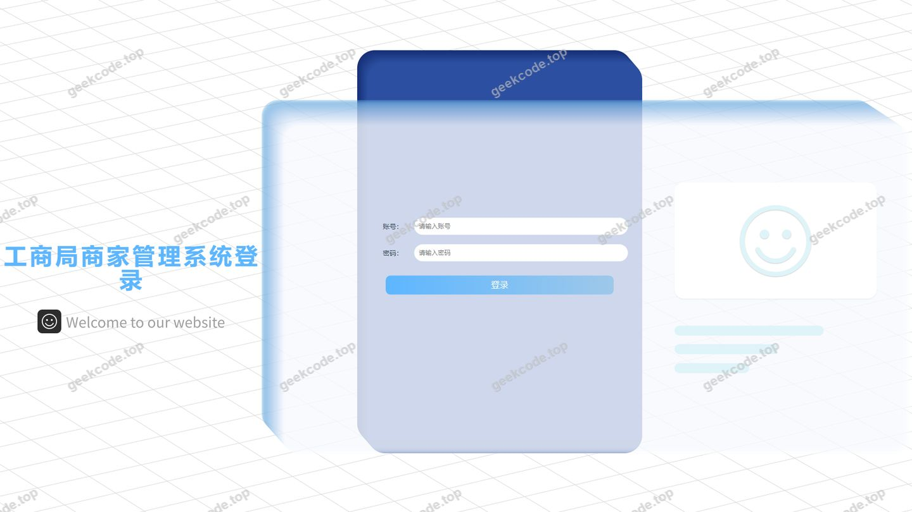
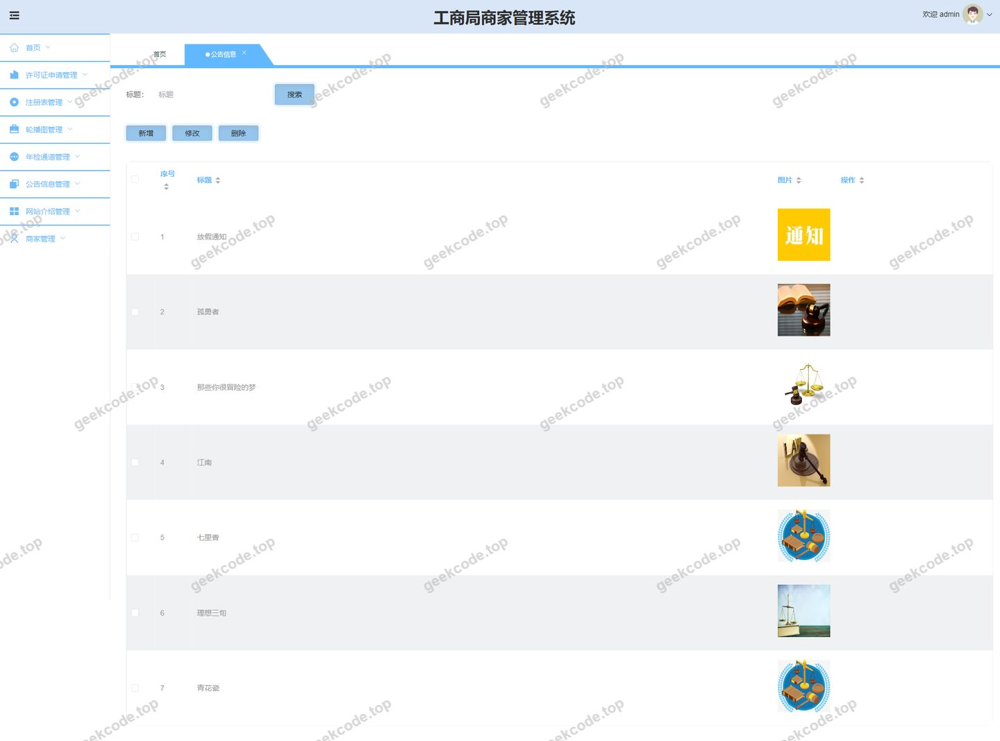
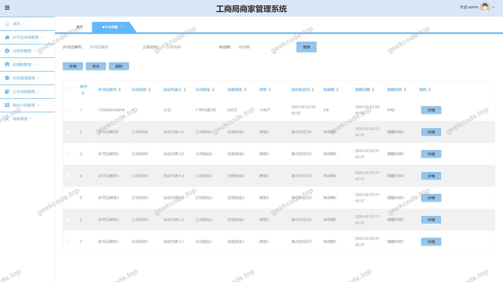
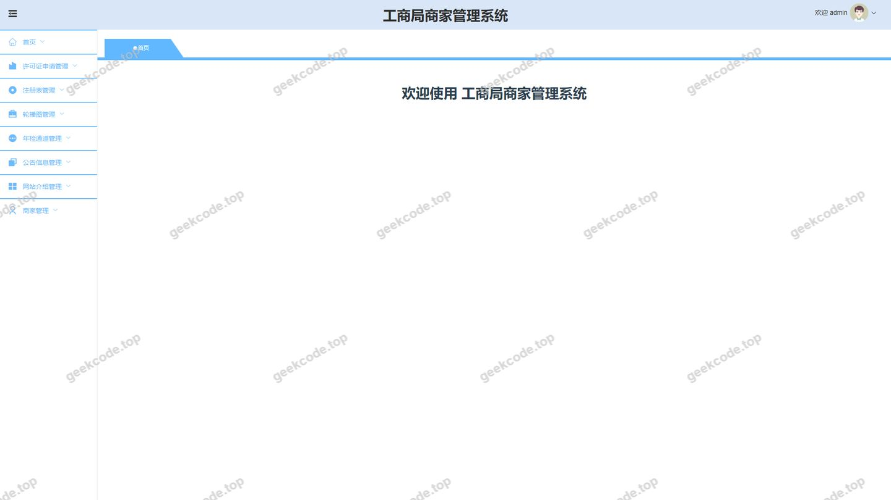
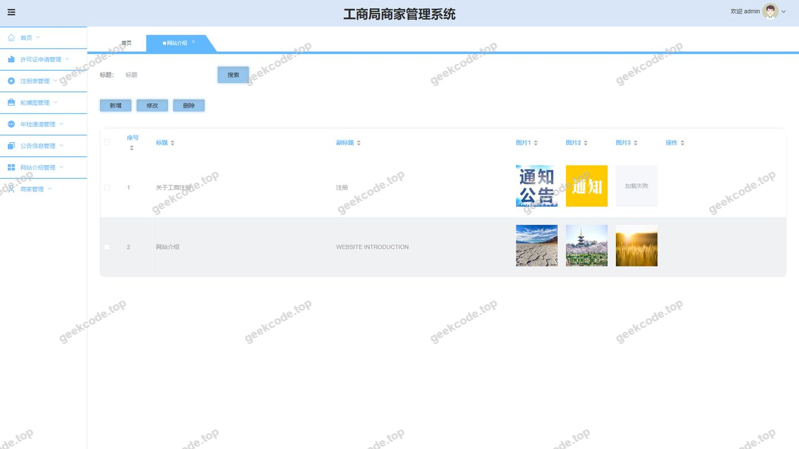
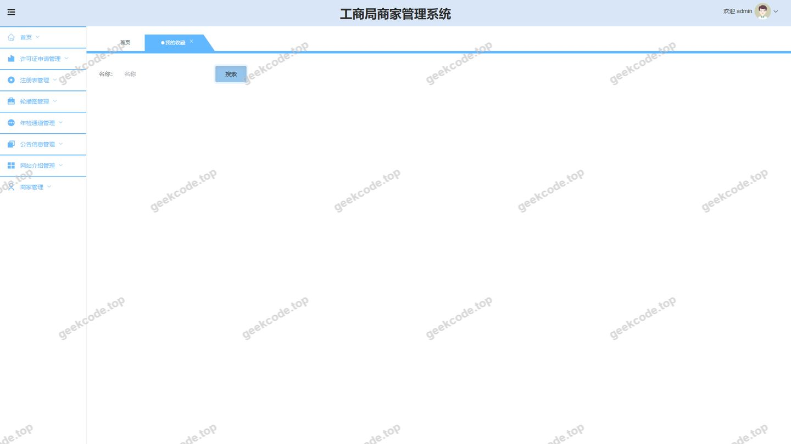
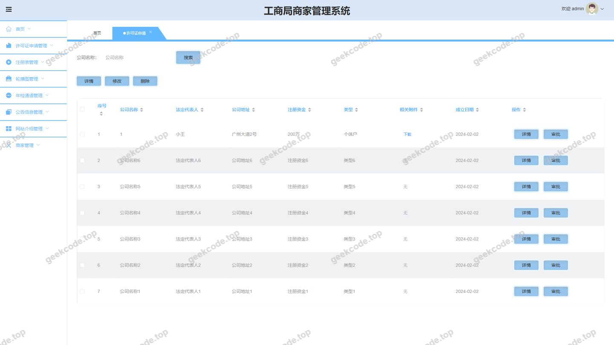
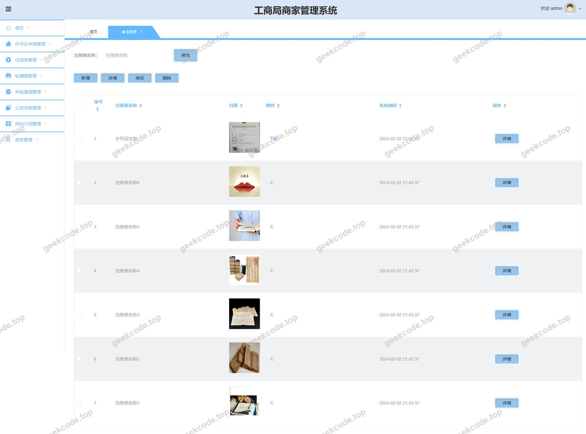

# java 工商局商家管理系统

> 🎓 **计算机毕业设计 · java 工商局商家管理系统**
>
> 本仓库只放**项目介绍 + 运行截图**（截图是站点带水印的原图，存在仓库 `images/` 里）。
>
> 👉 **完整可运行源码 / 数据库脚本 / 部署文档：[点我获取](https://geekcode.top/archives/java-%E5%B7%A5%E5%95%86%E5%B1%80%E5%95%86%E5%AE%B6%E7%AE%A1%E7%90%86%E7%B3%BB%E7%BB%9F?utm_source=github)**
>
> 💬 咨询微信：**ir9372**　|　🌐 更多项目：[极客代码 geekcode.top](https://geekcode.top/?utm_source=github)
>
> 📌 项目详情页：<https://geekcode.top/archives/java-%E5%B7%A5%E5%95%86%E5%B1%80%E5%95%86%E5%AE%B6%E7%AE%A1%E7%90%86%E7%B3%BB%E7%BB%9F?utm_source=github>

<table><td width="230" align="center"> <b>扫码加微信 ir9372</b></td><td valign="middle">📦 源码 = 项目介绍 + 全部运行截图 + 数据库 + 部署文档 👉 点上方任意截图，直接跳到 <b>极客代码 geekcode.top</b> 详情页</td></table>

---

<h1>java 工商局商家管理系统</h1>
<h2>项目概述</h2>

本项目为“java 工商局商家管理系统”，旨在构建一个基于 Web 的工商行政管理与商家服务平台，实现商家注册、许可证申请、年审提醒及后台审批的全流程数字化管理。系统采用前后端分离架构，面向工商管理人员（后台）与入驻商家（前台）。核心功能涵盖商家信息管理、注册表审核、许可证申请与审批、年度审查通知及系统公告发布。通过该系统的建设，能够有效提升工商部门对辖区商家的监管效率，简化商家办事流程，实现业务数据的标准化存储与快速检索，适用于地方工商局或市场监管部门的日常业务处理场景。

<h2>技术架构</h2>
<h3>1. 整体架构设计</h3>

系统采用经典的前后端分离模式（Vue-Separate），前端负责视图渲染与用户交互，后端提供 RESTful API 服务，两者通过 HTTP 协议进行数据交换。

<pre><code class="language-mermaid">graph TD
    subgraph Frontend [前端展示层]
        A[Vue.js 框架] --&gt; B[路由管理 Vue Router]
        A --&gt; C[状态管理 Vuex/Pinia]
        A --&gt; D[UI组件库 Element UI/Ant Design]
    end

    subgraph Backend [后端服务层]
        E[Spring Boot 应用] --&gt; F[Controller 控制层]
        F --&gt; G[Service 业务逻辑层]
        G --&gt; H[DAO/Mapper 数据访问层]
        H --&gt; I[MyBatis-Plus ORM]
    end

    subgraph Database [数据存储层]
        J[(MySQL 数据库)]
    end

    subgraph Security [安全认证]
        K[Apache Shiro]
    end

    B  |HTTP/JSON| F
    I  J
    F -.-&gt; |权限校验| K
</code></pre>
<h3>2. 核心技术选型</h3>
<ul>
<li><strong>后端框架</strong>：选用 <code>Spring Boot</code> 作为基础开发框架，利用其自动配置特性快速搭建项目骨架，集成 <code>spring-boot-starter-web</code> 提供 Web 服务能力。</li>
<li><strong>持久层框架</strong>：采用 <code>MyBatis-Plus</code> (<code>mybatisplus-spring-boot-starter</code>) 结合 <code>mybatis-spring-boot-starter</code>，在保留 MyBatis 灵活 SQL 编写能力的同时，通过 MP 提供的通用 CRUD 接口大幅减少样板代码，提高开发效率。</li>
<li><strong>安全框架</strong>：使用 <code>Apache Shiro</code> (<code>shiro-spring</code>) 进行身份认证与授权管理，确保只有具备相应权限的用户才能访问后台管理模块或执行敏感操作。</li>
<li><strong>数据库驱动</strong>：使用 <code>mysql-connector-java</code> 连接 MySQL 关系型数据库，存储商家信息、申请记录等结构化数据。</li>
<li><strong>工具类依赖</strong>：引入 <code>commons-lang3</code> 处理字符串与对象操作，<code>validation-api</code> 用于参数合法性校验，<code>protobuf-java</code> 可能用于特定数据序列化需求。</li>
</ul>
<h3>3. 数据库设计要点</h3>

数据库主要围绕“商家”、“申请”、“审批”三大实体建立关联。

<ul>
<li><strong>商家表 (Shangjia)</strong>：存储商家基本信息、账号密码、联系方式等。</li>
<li><strong>注册表 (Zhucebiao)</strong>：记录商家的初始注册申请详情及状态。</li>
<li><strong>许可证申请表 (Xukezhengshenqing)</strong>：存储商家提交的许可证申请材料、类型及提交时间。</li>
<li><strong>许可证审批表 (Xukezhengshenpi)</strong>：记录管理员对申请的审核意见、审批结果及时间。</li>
<li><strong>年审提醒 (Nianshentixing)</strong> &amp; <strong>年检通道 (Nianjiantongdao)</strong>：用于维护商家的年度报告提醒信息及在线填报入口配置。</li>
<li><strong>系统配置与公告 (Config/Systemintro/News)</strong>：存储网站介绍、公告信息及系统参数。</li>
</ul>
<h2>功能模块</h2>

根据路由配置与截图信息，系统分为前台用户端和后台管理端两部分。

<h3>1. 前台用户端 (商家/公众)</h3>

前台主要服务于商家自助办理业务及公众信息查询。

<ul>
<li><strong>首页与信息浏览</strong></li>
<li><code>/index/newsList</code>: 查看工商局发布的最新通知公告。</li>
<li><code>/index/systemintroList</code>: 查看网站介绍及办事指南。</li>
<li><code>/index/shangjiaList</code> / <code>/index/shangjiaDetail</code>: 浏览已公示的商家列表及查看详情。</li>
<li><strong>商家注册与管理</strong></li>
<li><code>/shangjiaRegister</code>: 新商家在线注册入口。</li>
<li><code>/index/shangjiaCenter</code>: 商家个人中心，查看自身信息及业务状态。</li>
<li><code>/index/storeupList</code>: 我的收藏（若支持收藏商家或政策）。</li>
<li><strong>业务办理模块</strong></li>
<li><strong>注册备案</strong>：<code>/index/zhucebiaoAdd</code> (新增注册申请), <code>/index/zhucebiaoList</code> (查询申请进度), <code>/index/zhucebiaoDetail</code> (查看详情)。</li>
<li><strong>许可证申请</strong>：<code>/index/xukezhengshenqingAdd</code> (提交许可证申请), <code>/index/xukezhengshenqingList</code> (查询申请列表), <code>/index/xukezhengshenqingDetail</code> (查看申请详情)。</li>
<li><strong>许可证审批查询</strong>：<code>/index/xukezhengshenpiList</code> (查看审批结果), <code>/index/xukezhengshenpiDetail</code> (查看具体审批意见)。</li>
<li><strong>年审相关</strong>：</li>
<li><code>/index/nianshentixingAdd/List/Detail</code>: 查看或接收年审提醒信息。</li>
<li><code>/index/nianjiantongdaoAdd/List/Detail</code>: 进入年检申报通道，填写并提交年度报告。</li>
</ul>
<h3>2. 后台管理端 (工商局管理员)</h3>

后台主要用于业务审批、数据管理及系统维护。

<ul>
<li><strong>登录与安全</strong></li>
<li>管理员专属登录页面，集成 Shiro 认证机制。</li>
<li><strong>业务审批中心</strong></li>
<li><code>/xukezhengshenqing</code>: 许可证申请管理。管理员可在此查看所有待审申请，并进行通过或驳回操作。</li>
<li><code>/xukezhengshenpi</code>: 许可证审批记录管理。查看历史审批日志，支持修改审批状态或补充备注。</li>
<li><code>/zhucebiao</code>: 注册表管理。审核新商家的注册资料，确认其合法经营资格。</li>
<li><code>/nianjiantongdao</code>: 年检通道管理。监控商家年报提交情况，催报未年检商家。</li>
<li><code>/nianshentixing</code>: 年审提醒管理。配置或发送针对特定商家的年审到期提醒消息。</li>
<li><strong>内容与信息管理</strong></li>
<li><code>/news</code>: 公告信息管理。发布、编辑、删除工商局官方通知。</li>
<li><code>/systemintro</code>: 网站介绍管理。更新关于本站的服务说明、办事指南等内容。</li>
<li><code>/shangjia</code>: 商家信息管理。全局查看、编辑、禁用或删除商家档案数据。</li>
<li><code>/storeup</code>: 收藏管理。查看用户收藏的数据记录（如适用）。</li>
<li><code>/config</code>: 系统配置管理。设置网站名称、Logo、轮播图等基础参数。</li>
</ul>
<h2>用户角色与权限</h2>

系统主要包含两种角色：<strong>普通商家用户</strong>（前台）和<strong>系统管理员</strong>（后台）。

<table>
<thead>
<tr>
<th align="left">角色</th>
<th align="left">描述</th>
<th align="left">可访问功能模块</th>
<th align="left">权限说明</th>
</tr>
</thead>
<tbody><tr>
<td align="left"><strong>普通商家用户</strong></td>
<td align="left">在平台注册的个体户或企业代表</td>
<td align="left"><strong>首页</strong>: 新闻列表, 网站介绍<strong>个人中心</strong>: 商家详情, 我的收藏<strong>业务办理</strong>: 注册表(增/查/详), 许可证申请(增/查/详), 许可证审批(查/详), 年审提醒(增/查/详), 年检通道(增/查/详)<strong>注册</strong>: 商家注册页</td>
<td align="left">仅能操作与自己账号绑定的数据；只能提交申请，不能审批；可查看公开的商家信息和公告。</td>
</tr>
<tr>
<td align="left"><strong>系统管理员</strong></td>
<td align="left">工商局工作人员</td>
<td align="left"><strong>后台登录</strong>: 管理员专用入口<strong>业务管理</strong>: 许可证申请, 许可证审批, 注册表, 年检通道, 年审提醒<strong>内容管理</strong>: 公告信息, 网站介绍<strong>数据管理</strong>: 商家信息, 我的收藏(查看全量)<strong>系统设置</strong>: 系统配置</td>
<td align="left">拥有最高权限；可对所有商家的数据进行增删改查；负责审核许可证申请和注册资料；发布和维护全站公告及配置。</td>
</tr>
</tbody></table>
<h2>项目特色与创新点</h2>
<ol>
<li><strong>全流程闭环管理</strong>：系统覆盖了从商家“注册 -&gt; 许可证申请 -&gt; 审批 -&gt; 年审提醒 -&gt; 年检申报”的完整生命周期，实现了工商业务的线上化闭环，减少了线下跑腿次数。</li>
<li><strong>前后端分离架构</strong>：采用 Vue + Spring Boot 分离开发模式，提升了页面的响应速度和用户体验，同时使得后端接口更易于维护和扩展，符合现代 Web 开发标准。</li>
<li><strong>基于 Shiro 的安全管控</strong>：引入 Apache Shiro 框架，实现了细粒度的权限控制，确保后台管理数据的安全性，防止未授权访问和数据篡改。</li>
<li><strong>高效的数据持久层</strong>：利用 MyBatis-Plus 的强大能力，在处理复杂的商家查询和多表关联（如申请与审批表的关联）时，保持了代码的简洁性和执行的高效性。</li>
<li><strong>动态业务配置</strong>：通过 <code>/config</code> 和 <code>/systemintro</code> 模块，管理员可以灵活调整网站展示内容和基础配置，无需重新部署代码即可适应政策变化或界面调整需求。</li>
</ol>
<h2>部署环境</h2>

为确保系统正常运行，需准备以下软件环境：

<ol>
<li><strong>操作系统</strong>：Windows 10/11 或 Linux (CentOS 7+, Ubuntu 20.04+)</li>
<li><strong>Java 运行环境</strong>：JDK 1.8 或 JDK 11 (推荐 JDK 1.8 以兼容常见 Spring Boot 版本)</li>
<li><strong>数据库</strong>：MySQL 5.7 或 MySQL 8.0</li>
<li><strong>Web 服务器</strong>：内置 Tomcat (由 Spring Boot Starter Web 提供) 或外部 Nginx (用于前端静态资源托管及反向代理)</li>
<li><strong>Node.js 环境</strong>：Node.js v14+ (用于编译 Vue 前端代码)</li>
<li><strong>包管理工具</strong>：npm 或 yarn (用于安装前端依赖)</li>
<li><strong>Maven</strong>：Apache Maven 3.6+ (用于后端项目的依赖管理和打包构建)</li>
</ol>
<h2>五、技术特性</h2>
<ul>
<li>前后端分离架构，前端独立部署</li>
<li>使用 MyBatis-Plus 简化数据访问层开发</li>
<li>集成 Shiro 权限框架实现角色权限控制</li>
</ul>
<h2>六、功能模块截图</h2>
<h3>后台管理端</h3>
<h4>后台-登录页</h4>

<h4>后台-公告信息</h4>

<h4>后台-年审提醒</h4>

<h4>页面-首页</h4>

<h4>后台-网站介绍</h4>

<h4>后台-我的收藏</h4>

<h4>后台-许可证申请</h4>

<h4>后台-注册表</h4>

---

## 获取完整源码

| 项目 | 说明 |
| --- | --- |
| 项目名 | java 工商局商家管理系统 |
| 运行截图 | 本文 8 张（站点带水印原图，仓库 `images/` 目录） |
| 完整源码 | [https://geekcode.top/archives/java-%E5%B7%A5%E5%95%86%E5%B1%80%E5%95%86%E5%AE%B6%E7%AE%A1%E7%90%86%E7%B3%BB%E7%BB%9F?utm_source=github](https://geekcode.top/archives/java-%E5%B7%A5%E5%95%86%E5%B1%80%E5%95%86%E5%AE%B6%E7%AE%A1%E7%90%86%E7%B3%BB%E7%BB%9F?utm_source=github) |
| 咨询微信 | **ir9372**（备注：jingpin-yuanma） |
| 更多项目 | [极客代码 geekcode.top](https://geekcode.top/?utm_source=github) |

> 需要源码、部署、改配置、跑不起来等问题，加微信 ir9372 沟通，说明项目名即可。
